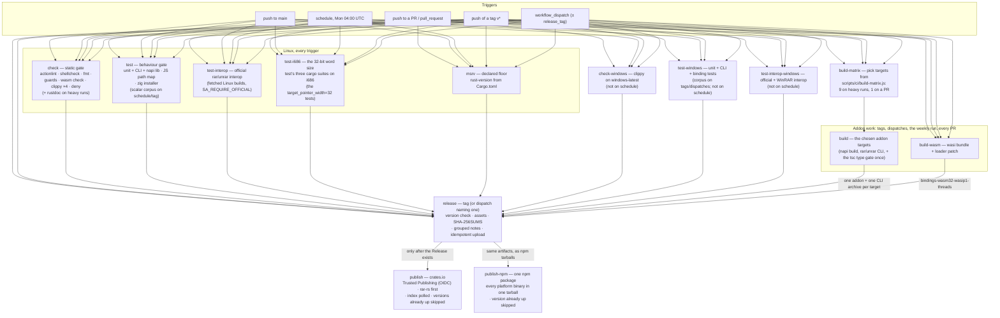

# CI: what runs, why it is shaped like this

`.github/workflows/CI.yml` is the only workflow and the only gate. This page is
the map: the job graph, what each job is allowed to prove, what it costs, and
what was deliberately left out. The workflow file stays the source of truth —
when the two disagree, fix one of them in the same commit.

> Last verified: 2026-11-25 @ `6c6803d8`; implementation details are
> authoritative in the workflow file.

## The graph

Two properties of the shape are worth reading off the diagram:

- **Nothing is upstream of
  `check`/`test`/`test-interop`/`test-i686`/`msrv`/`check-windows`/`test-windows`/`test-interop-windows`/`build-matrix`.
  They start together on every trigger, so a PR gets its answer in the time of
  the slowest job instead of the sum. The price is that a formatting mistake also
  burns the test minutes; paid on purpose — a red `check` names the problem, and
  a serialised pipeline would give one failure at a time.
- **`release` and the two publish jobs are the only ones with `needs`.**
  Everything else is independent, so a broken job can never hide behind an
  earlier failure, and `release` cannot assemble a partial artifact set. `build`
  needs `build-matrix` only because it reads the target list from it. Both
  `publish` and `publish-npm` need `release` because a version that reaches a
  registry cannot be replaced — crates.io only yanks, npm only deprecates — so a
  version must only ship after the tag has produced its Release.

## What each job is allowed to prove

| Job                 | Proves                                                                                                                                                                                                                                                                                                     | Not merged into a neighbour because                                                                                                                                                                                                                                                                         |
| ------------------- | ---------------------------------------------------------------------------------------------------------------------------------------------------------------------------------------------------------------------------------------------------------------------------------------------------------- | ----------------------------------------------------------------------------------------------------------------------------------------------------------------------------------------------------------------------------------------------------------------------------------------------------------- |
| `check`             | The tree compiles, is formatted, is lint-clean, its manifest invariants hold, its dependencies are legal, its docs build.                                                                                                                                                                                  | Runs no test suite: a red `check` and a red `test` mean different things, and the log you open first should be the right one.                                                                                                                                                                               |
| `test`              | Behaviour: library unit tests, the CLI suites, the binding's Rust tests, the JS path-mapping test, the zig installer's failure modes — plus the 10 generated legacy-corpus targets, which the first step already runs under `--all-features`; the second, scalar-build run of them is `schedule`/tag only. The `official_interop` target still compiles here but self-skips (no `SA_OFFICIAL_*`); its real run is `test-interop`. | Same reason, mirrored. It also installs no clippy/rustfmt and no wasm target — `-D warnings` on the test profile would report a warning that `check` already fails on.                                                                                                                                      |
| `test-i686`         | `test`'s three commands — `rar-rs --all-features`, the rar-cli hermetic targets, the binding's lib tests — on `i686-unknown-linux-gnu`, where the `#[cfg(target_pointer_width = "32")]` regression tests (rar29's VM block-start overflow, rar4's `LONG_BLOCK` narrowing, the rar5 dictionary caps, the decoder's dictionary test) finally execute at all. The CLI SFX suites build their console stub for that same triple (a `build.rs` exports cargo's `TARGET`, which a nested `cargo build` does not inherit), so the stub is 32-bit and runnable here too. No WinRAR fetch, so the corpus suites self-skip here. | A 32-bit word size is a second axis, not a second platform: every pointer-width bug in this tree was `usize == u32` arithmetic that the x86_64 suites cannot see, and a release build wraps it silently instead of panicking. Linux/glibc rather than Windows x86 because that is the target the Debian i386 port (where the reports came from) actually runs. |
| `msrv`              | The `rust-version` in `Cargo.toml` compiles, using exactly that toolchain with `--all-features`.                                                                                                                                                                                                           | `check`/`test` run whatever `stable` is today, so without this job `rust-version` is a comment. Kept separate so the failure reads "the floor broke", not "the tree broke".                                                                                                                                 |
| `check-windows`     | Everything under `#[cfg(windows)]` compiles and is clippy-clean (`cargo clippy --workspace --all-features --all-targets -- -D warnings`). | Split from the tests for the same reason Linux splits `check`/`test`: a red run names the failure kind. The old single job saved "runner cost", but this repository is public and Actions minutes are free — the split only costs a second checkout/toolchain/cache restore (time, not money). |
| `test-windows`      | The `#[cfg(windows)]` code that only *running* exercises: the CLI switch contract, the unit tests, the binding's `error.rs`/`guard.rs` tests; on tags and dispatches, also the generated corpus. | Same split as `check-windows`. The interop suites it used to carry are `test-interop-windows`; only the heavier corpus stays release-shaped, so this stays a plain unit/CLI run. |
| `test-interop`      | The official rar/unrar cross-checks on the fetched Linux builds (`SA_OFFICIAL_*`, `SA_REQUIRE_OFFICIAL=1`): our archives validated by the official tools, and theirs read by us. | Split out of `test` so it runs in parallel with the suite it was buried in, and so `SA_REQUIRE_OFFICIAL=1` makes a missing tool a failure instead of the skip marker a bare `test` run printed — a green `test` never proved the official tools read our archives. |
| `test-interop-windows` | The same cross-checks against the Windows builds (6-23 writes RAR4, 7-23 reads), plus `rar-cli`'s `winrar_interop` driving a real `WinRAR.exe`/`UnRAR.exe` (`SA_WINRAR_DIR`). | Split out of `test-windows`, where the two suites were ~3 of the job's ~6 minutes; in a job of its own the compile and run happen in parallel with the unit/CLI work instead of after it. Fetches the releases every push (cached). |
| `build-matrix`      | Which addon targets this event builds: the whole list on tags, dispatches and the weekly run; the one `smoke` entry on a pull request.                                                                                                                                                                     | The list is data (`scripts/ci/build-matrix.js`), not a `matrix:` literal, because two events need two different subsets of the same list, and a duplicated literal would let the PR smoke target drift away from the target the release builds.                                                             |
| `build` (`×1`–`×9`) | A loadable `.node` exists for each target the selector chose, plus the `tsc` type gate once (on the entry that generated `binding.d.ts`), plus a `rar`/`unrar` tarball on the seven rows whose target needs no fresh cross linker.                                                                          | One job per target so `fail-fast: false` reports every broken platform in one run instead of one per push. On a PR one target runs, so the napi pipeline and the type gate are exercised before a tag (see below).                                                                                          |
| `build-wasm`        | The wasi bundle: 8 files, loader patched for Windows host paths.                                                                                                                                                                                                                                           | Cheap and independent; a red wasm run should not make 9 addon jobs look broken.                                                                                                                                                                                                                             |
| `release`           | The tag, the version match, the exact asset set, the checksums, the notes; and that re-running it updates instead of failing.                                                                                                                                                                              | —                                                                                                                                                                                                                                                                                                           |
| `publish`           | That all three crate versions on the index match the tag, in dependency order, through a short-lived OIDC token rather than a stored secret; already-published versions are skipped.                                                                                                                       | Publishing cannot be undone on crates.io, so it is the one job that must not run until every other gate has passed — `needs: release` is that ordering, and it makes a re-release dispatch a gap-filler instead of a failure.                                                                               |
| `publish-npm`       | That the one npm package carries the release payload's bytes — every addon `napi.targets` promises, the WASI binary and worker scripts, the notices, and a `browser.js` that points at the copy inside the package — and that a version already on the registry is skipped.                                | The same argument as `publish`, from the other side: keeping them apart means a crates.io failure does not hide an npm one, and each can be re-run alone through `release_tag`. npm's first publish for a new name still needs a token — `publish` has no such gap because every crate name exists already. |

## The release path is rehearsed before the tag

A green pull request used to say nothing about a release: the addon build, the
`tsc` type gate, the wasi bundle and the asset contract all ran for the first
time on the tag. Five changes close that gap — two cost seconds, three cost
minutes:

| Release-only step                                                              | Where it now runs on a PR                        | What it costs          |
| ------------------------------------------------------------------------------ | ------------------------------------------------ | ---------------------- |
| asset contract (9 addons, 7 CLI archives, 8 WASI files, identical loaders, license flattening) | `check`, as `scripts/ci/test-release-scripts.sh` | seconds                |
| release-notes grouping and the previous-tag range                              | same fixture test, in `check`                    | seconds                |
| `napi build` + `tsc` type gate                                                 | `build`, on the one `smoke` matrix entry         | one addon build        |
| wasi bundle + loader patch                                                     | `build-wasm`                                     | ~4 min                 |
| the eight cross targets (musl, arm, darwin, win32)                             | weekly schedule, full matrix, no publish         | weekly                 |
| the corpus on Windows, against the official WinRAR builds                      | tag and dispatch (same runs that publish)        | minutes                |
| crate publish order, index polling, skip-if-already-published                  | `check`, in the same fixture test (stub index)   | 2 curl-less assertions |
| npm tarball contents, payload filling, skip-if-already-published               | same fixture test (stub `npm` + stub payload)    | seconds                |

No rehearsal gaps are left in that table, but three rows are release-shaped
rather than per-PR on purpose: a second _library configuration_ of a suite that
already runs on every push, and a Windows corpus that generates and decodes its
whole legacy set (the tool fetch is no longer the reason — the interop suites
need it on every push). Both run on every tag before `release` consumes the
artifacts, which is the run that matters; the weekly job covers the first, so a
break is found within seven days instead of at the tag. The third is the token
exchange: a `release_tag` dispatch naming a tag whose versions are all on the
index runs `publish` end to end and publishes nothing, which is the rehearsal —
and `publish-npm` in the same run rehearses the skip rule against the npm
registry.

The rules that used to be shell inside `release` are now
`scripts/ci/collect-release-assets.sh` and `scripts/ci/release-notes.sh`, which
is what makes the fixture test possible at all. The fixture test also asserts
that the build matrix's addon names — and its `cli` archive names, one per row
that builds the `rar`/`unrar` binaries — equal the ones the release demands, so
the lists cannot disagree silently.

What a PR still cannot prove, by construction: that `gh release` accepts the
upload, and that the eight cross-target binaries load on their platforms. The
first is covered by idempotence (a re-run converges instead of failing) and by
`workflow_dispatch` with `release_tag` (same code path, an existing tag); the
second by the weekly full-matrix run. Deliberately not bought: nine addon builds
on every PR — that is the runner bill this shape exists to avoid.

## Cost

Rough job counts and runner time per event (Windows runners are slower and share a smaller pool; on a public repository the minutes themselves are free):

| Event                      | Jobs | Notes                                                                                                                                                                  |
| -------------------------- | ---- | ---------------------------------------------------------------------------------------------------------------------------------------------------------------------- |
| PR                         | 9    | ~2 min faster than a run that also re-ran the corpus against a scalar build; the static gates answer in ~2 min, the single addon build sets the tail                   |
| push to main               | 6    | no addon work — the pull request already built that tree                                                                                                               |
| push of a tag              | 20   | dominated by the 9-target build matrix; `release`, then `publish` (usually skipping every crate) and `publish-npm` in parallel                                         |
| weekly schedule            | 15   | the full matrix + wasi bundle, so the heavy path is proven without publishing; also the advisory DB and "does today's stable build it"                                 |
| dispatch, no `release_tag` | 17   | the smoke path for workflow changes: builds the matrix against the default branch, publishes nothing                                                                   |
| dispatch, `release_tag`    | 20   | `release` re-uploads the assets, `publish` proves the OIDC exchange and skips every version already on the index, `publish-npm` does the same against the npm registry |

Caches that keep this down: `Swatinem/rust-cache` with one `linux` key shared by
`check`/`test` and one `windows` key shared by `check-windows`/`test-windows`
(same toolchain and lock in each pair, so one dependency cache serves both), a
separate `linux-i686` key (`test-i686` builds a different target triple), a
separate `msrv` key (different toolchain), a per-target `cargo` key for the
build matrix, and the zig/cargo-zigbuild and WinRAR-download caches.

## Decisions in this shape

| Decision                                                     | Why                                                                                                                                                                                                                                                                                                                                                                                                                   |
| ------------------------------------------------------------ | --------------------------------------------------------------------------------------------------------------------------------------------------------------------------------------------------------------------------------------------------------------------------------------------------------------------------------------------------------------------------------------------------------------------- |
| No `paths-ignore`                                            | It skipped a tag whose diff happened to be markdown-only (silent non-release) and skipped the required checks on docs-only PRs (permanent "waiting"). A docs push is worth the minutes.                                                                                                                                                                                                                               |
| `workflow_dispatch.inputs.release_tag`                       | A release that died mid-upload used to be retryable only by deleting and re-pushing the tag.                                                                                                                                                                                                                                                                                                                          |
| `release` is idempotent                                      | `gh release view` → `edit --notes-file` + `upload --clobber`; else `create --verify-tag`. Re-running publishes the same assets instead of a second tag, so a run that died mid-upload converges. The consumer pins digests, so a re-run that changes a byte is a re-pin on that side — Windows addons are not reproducible, Linux and macOS are.                                                                      |
| Notes are generated from commits                             | `--generate-notes` renders once and never refreshes on a re-release; grouping `feat`/`fix`/`perf` from `git log --no-merges` also makes the notes reviewable in the diff of this file.                                                                                                                                                                                                                                |
| `cancel-in-progress` only for PRs                            | Cancelling a `main` or tag run can leave a release half-published; a PR run only wastes minutes.                                                                                                                                                                                                                                                                                                                      |
| actionlint + shellcheck are steps, actionlint is verified    | The workflows are the one part of the repo nothing compiled. `scripts/ci/run-actionlint.sh` downloads a pinned tarball and checks it against the SHA-256 from actionlint's own release index. shellcheck runs at `-S warning` — at the default style level its info findings fire on deliberate constructs.                                                                                                           |
| `msrv` reads `Cargo.toml`                                    | The version lives in one place; a job that hard-codes it would let the manifest drift.                                                                                                                                                                                                                                                                                                                                |
| `publish` uses Trusted Publishing, not a secret              | crates.io mints a token per run through `rust-lang/crates-io-auth-action@v1` and `id-token: write`, so a stolen repository secret cannot publish a version; the trust is per crate (`rar-rs`, `rar-cli`, `rar-rs-napi`) and names this workflow file. It also waits on `needs: release`, because a version that reached the registry cannot be replaced — only yanked.                                                |
| `publish` skips what is already on the index                 | A `release_tag` dispatch exists to repair a half-published release; failing on the versions that did make it would defeat that. The skip also makes a re-pointed tag a no-op instead of a second permanent version.                                                                                                                                                                                                   |
| `publish` overlays `scripts/ci` from its own commit          | `cargo publish` ships the working tree, so the checkout is the tag's tree; but a repair dispatch may name a tag cut before a fix to these scripts, and then the run would fail on a file that did not exist yet. Tooling from the workflow's commit, crates from the tag.                                                               |
| npm ships as one package, not one per target                 | `napi`'s generated loaders resolve `./<binary>.<platform>.node` and `./<binary>.wasm32-wasi.wasm` next to themselves before they fall back to a per-platform package, so a single tarball loads everywhere. One name, no `optionalDependencies` to keep in step, one registry entry to configure — paid for in bytes: an install downloads ~14 MB instead of the ~1.4 MB it can load.                                 |
| `publish-npm` fills from the release payload                 | The payload is what the `release` job checksums, so npm serves byte-for-byte what the GitHub Release serves, and a target whose addon is missing fails before a package that cannot load is published — the reason `collect-release-assets.sh` runs first instead of trusting the worktree. The count comes from `napi.targets`, so a dropped build is caught without a hand-kept table.                              |
| `publish-npm` names the WASI artifacts outright              | They are ordinary `files` entries rather than globs, because a package that ships the `.wasm` but not `wasi-worker.mjs` installs fine and then cannot spawn — the failure this repo's own payload had. The script asserts every listed entry landed in the staged package.                                                                                                                                            |
| `publish-npm` derives the target count, not the target names | `napi.targets` holds Rust triples (`win32-x64-msvc` comes from `x86_64-pc-windows-msvc`) and the artifacts are named in napi's spelling, so the check is arithmetic: one `.node` in the payload per native target, plus the `.wasm` named outright. A hand-kept triple-to-platform table would be one more place to forget — the same argument as the build matrix.                                                   |
| `publish-npm` does not call `napi pre-publish`               | That helper publishes a package per platform **and** uploads the same files as GitHub Release assets, which would race the `release` job and split the payload back up; one package published from the same payload keeps the asset set and the registry contents identical.                                                                                                                                          |
| npm publishes with `--provenance`                            | `id-token: write` is already granted for crates.io's OIDC exchange, so the same run can attest the tarballs; `--access public` is what an unscoped publish needs on the first name and stays correct afterwards.                                                                                                                                                                                                      |
| Dependabot, grouped                                          | The repo had already drifted (`actions/cache@v4` beside `v6`). Dependabot does not know `rust-version`, so a bump that raises the floor surfaces as a red `msrv` job.                                                                                                                                                                                                                                                 |
| `retention-days: 7` on the artifacts                         | `release` consumes them in the same run; the 90-day default stores nine addons for three months.                                                                                                                                                                                                                                                                                                                      |
| The addon matrix is data, in `scripts/ci/build-matrix.js`    | Two events need two subsets of one list — nine entries on a tag, one on a PR. A `matrix:` literal per job would duplicate the targets, and a duplicated list is how the smoke target silently stops being the target that ships. Its `cli` field names the `rar`/`unrar` archive built on the rows whose target needs no fresh cross linker (armv7 and aarch64-linux-gnu are addon-only), so a platform is one row here, not a second table. |
| A PR builds one addon, not nine                              | Rehearses the napi pipeline and the `tsc` type gate (which otherwise first ran on a tag) for ~8 runner-minutes in parallel, so wall clock does not move; nine would be the bill this shape avoids.                                                                                                                                                                                                                    |
| A PR builds the wasi bundle                                  | ~4 minutes, in parallel, and the only thing that patches the loader for Windows host paths — a break there is a release break, not a Linux-gate break.                                                                                                                                                                                                                                                                |
| The weekly run builds the full matrix                        | The eight cross targets are unreachable on a PR without wasting minutes; a schedule proves them without publishing, so "the tag failed on armv7" stops being the first signal.                                                                                                                                                                                                                                        |
| clippy ×4, not ×5                                            | `crates/rar` has `default = []` and exactly two features, so `--features parallel,simd` _is_ `--all-features`, which the workspace step already runs. The ungated build and the two single-feature builds are what the matrix still adds — each one is a configuration the workspace build cannot see.                                                                                                                |
| The scalar-build corpus run is `schedule`/tag only           | The `--all-features` step above it already executes those suites on every push, so what this step adds is the same assertions against a `default = []` library — worth one extra compile of the crate plus every test binary, not worth it on every push. `check` keeps the scalar configuration compiling on every push.                                                                                             |
| The Windows corpus is release-shaped                         | Its tool fetch is now unconditional (the interop suites need the tools on every push), but the corpus generates and decodes its whole legacy set, which is worth a tag rather than every push. The `#[cfg(windows)]` unit tests, clippy and both interop suites stay on every PR.                                                                                                                          |
| The 32-bit gate is Linux i686, not Windows x86               | Every pointer-width bug here arrived from Debian's i386 port, so `i686-unknown-linux-gnu` is the target those consumers run and the one a fix has to hold. It is also the cheapest way to buy a 32-bit word size (Linux 1×, one `apt-get install gcc-multilib`) and it runs on every push, not only at the tag. The Windows x86 addon is the only published 32-bit binary but is not the axis any of the bugs came from — it is built for the release, never run by a test. |
| No markdown gate                                             | `dprint` left CI: it pulled the npm package and `plugins.dprint.dev` on every run, so a network hiccup was a red build unrelated to the change, and its markdown plugin wraps on whitespace only — it cannot break Chinese prose, so on this repo's docs it mostly re-flowed text into meaningless breaks. It stays in `dprint.json` and in `scripts/ci-lint.sh` for whoever has the binary on PATH, where a failing check is a `WARN` that does not stop the rest of the local gate. |
| One installer for zig and cargo-zigbuild                     | Only the two musl rows need either, and they need both (`napi build -x` is cargo-zigbuild, which drives `zig`). The script installs whichever half its version variable names, which is also what lets `scripts/ci/test-install-zig.sh` exercise the zig half alone.                                                                                                                                                  |

## Deliberately absent

- **`cargo publish --dry-run` / `cargo package` gate.** Not implemented yet;
  when it lands it belongs in `release` before the upload, not in
  `check`, because it validates the packaged crate rather than the tree.
- **A macOS job on PRs.** There is no `cfg(target_os = "macos")` in the tree
  (the platform-specific code is `unix` 66 sites and `windows` 102), so macOS
  adds no compile coverage on a PR; the `aarch64-apple-darwin` matrix entry
  exists to publish an addon. Adding a macOS job would buy runner minutes and
  nothing else.
- **SHA-pinning third-party actions.** They are pinned by major tag and tracked
  by Dependabot; the trade-off is a supply-chain surface in exchange for
  readable versions. Revisit if the repo ever gets a release key worth stealing
  (both registries use a per-run OIDC token, so no long-lived secret is stored).
- **The JS/WASI binding suites in CI.** They were the one flaky gate, so they
  stay local. `docs/testing.md` is where the local covers them.

## Changing it safely

1. Edit `CI.yml` (or a script it calls; the scripts under `scripts/ci/` exist so
   the same check can run locally — see `scripts/ci-lint.sh`).
2. `scripts/ci-lint.sh --no-tests` — actionlint, shellcheck, the release
   fixtures, fmt, the guards, clippy, rustdoc. This is the same set `check`
   runs.
3. `bash scripts/ci/test-release-scripts.sh` on its own when editing the release
   scripts (`collect-release-assets.sh`, `release-notes.sh`,
   `publish-crates.sh`, `publish-npm.sh`) or the build matrix (it is part of
   step 2 as well).
4. `workflow_dispatch` with an empty `release_tag` — builds the whole matrix
   against the default branch and stops before `release`. That is the only way
   to test the heavy half without cutting a tag.
5. To re-publish an existing tag: dispatch with `release_tag` set to it. If its
   versions are already on crates.io or npm, the publish jobs print a `skip` for
   each and the run is the rehearsal of the OIDC exchange and the skip rule. The
   overlay is **tooling only**: `scripts/ci` comes from the workflow's commit,
   but `Cargo.toml` and `package.json` come from the tag, so a change to a
   manifest still needs a new tag — dispatching `v0.15.2` fails at
   `does not list NOTICE`, because that tree's `package.json` predates the
   `files` additions. The validation runs _before_ the skip for this reason: a
   re-run of a broken payload fails instead of reporting a clean skip.
6. A **new** crate name cannot be published through OIDC: crates.io needs the
   crate to exist before a Trusted Publisher can be attached to it, so the first
   upload is a manual `cargo publish` with `publish-new`. npm has the same
   limitation for a new package name, so the first npm publish of
   `@yjdyamv/rar-rs` was done by hand with a token; once a Trusted Publisher
   entry names this workflow, the job needs no secret (it already asks for
   `id-token: write` and passes `--provenance`).
